# 껄무새 (GGParrot)

- 껄무새 웹에서 만든 매크로를 이 PC에서 실행하는 프로그램.
- Tauri 2(Rust + React)로 만듦.
- **macOS와 Windows**에서 같은 방식으로 동작함.
- 앱 버전:
  - `src-tauri/Cargo.toml`의 `[workspace.package] version` 한 곳에만 적음.
  - `v{major}.{minor}.{patch}` 체계를 씀. `0.<서버 연동 레벨>.<패치>` — 지금은 `0.21.x`(서버 연동 레벨 21)이고 PR(스쿼시 머지)마다 패치 번호를 올림.
- 이름:
  - 화면에는 한국어 **껄무새**, 영문 **GGParrot**(띄어쓰기 없음). Windows 설치·시작 메뉴·프로그램 목록은 한국어 '껄무새'.
  - 저장소·실행 파일·패키지·키체인·데이터 폴더는 웹 저장소(`gg_parrot`)와 구분되게 `ggparrot-desktop`.
  - 번들 식별자는 `com.ggparrot.desktop`(역도메인 형식).
  - 웹의 **실행기 열기**는 `ggparrot://` 링크로 이 앱을 엶.
- 서버 연동 레벨(server link level, 코드 `SERVER_LINK_LEVEL`): 앱 버전의 가운데 숫자(지금 **21**).
  - 따로 적는 곳이 없음 — 빌드할 때 앱 버전의 마이너를 그대로 씀. 레벨을 올리려면 `Cargo.toml` 버전 한 곳을 `0.<새 레벨>.0`으로 바꿈.
  - 서버가 기능마다 정한 최소 레벨과 이상인지만 비교해 기능을 열고 닫는 정수. 기능별 최소 레벨은 서버가 정함. 모자라면 426('실행기 vN 이상으로 업데이트').
  - 서버가 정한 필드 이름 `runner_version`으로 보냄. 번호의 출처는 Python 실행기 exe의 배포 번호(`runner-vN`).
  - 이 앱은 그 레벨의 서버 연동 기능을 모두 갖춘 뒤에만 올림. 숫자로만 보냄(`0.19.1` 같은 앱 버전을 보내면 426으로 막힘).
  - `ggparrot://` 딥링크 규약 번호(v=1·v=2)와는 다른 것.
- 대상: macOS 11 이상(Apple Silicon·Intel), Windows 10 이상(x64)
- 모바일(iOS·Android)은 지원하지 않음.
  - OS가 백그라운드 앱을 멈춰 5초 간격의 서버 보고를 유지할 수 없기 때문.
- 변경 기록: [CHANGELOG.md](CHANGELOG.md)
- 다음 작업: [docs/backlog.md](docs/backlog.md)

## 화면

| 실행(봉 차트·지표선·기다리는 선) | 다크 테마 |
|---|---|
| 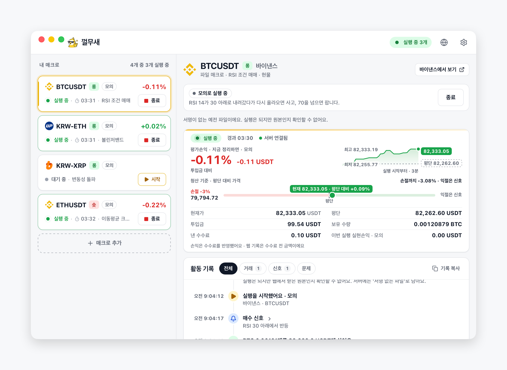 | 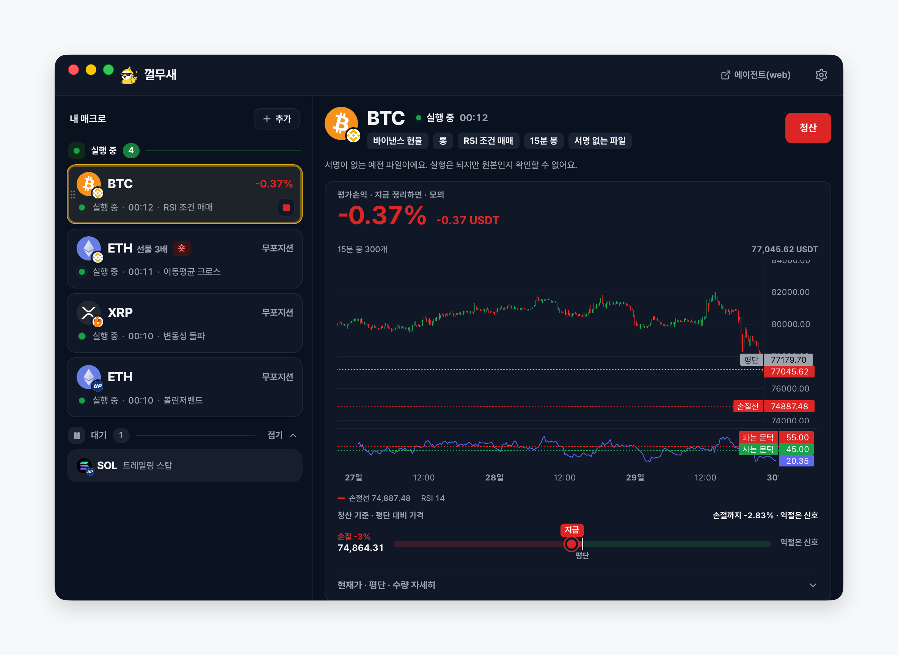 |
| **첫 화면** | **매크로 추가** |
| 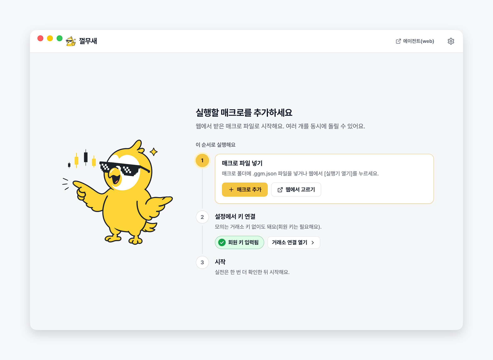 | 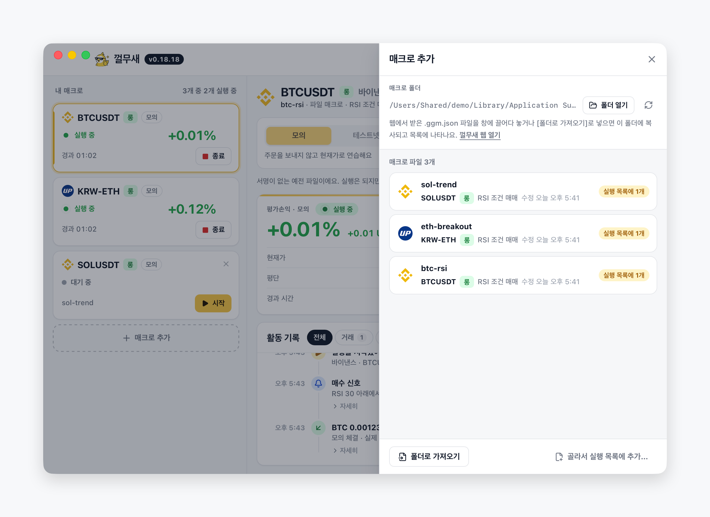 |
| **설정·거래소 연결** | **설정·창·화면(테마·알림)** |
| 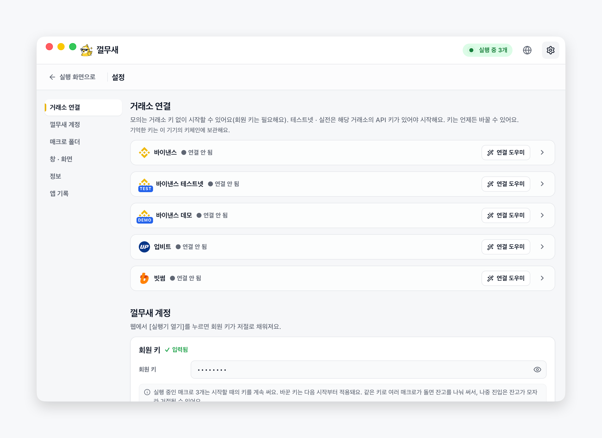 | 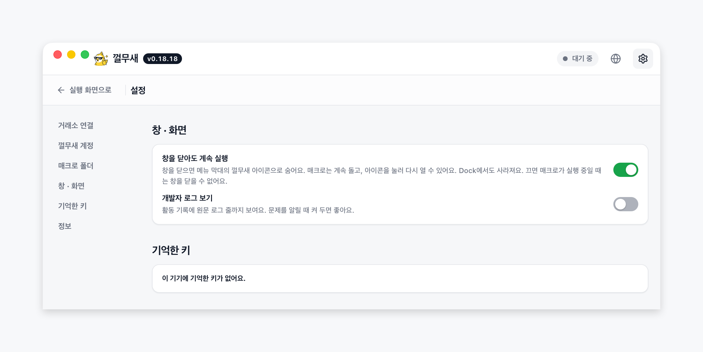 |
| **메뉴 막대(트레이) 메뉴** | **설정·정보(문의용)·앱 기록** |
| 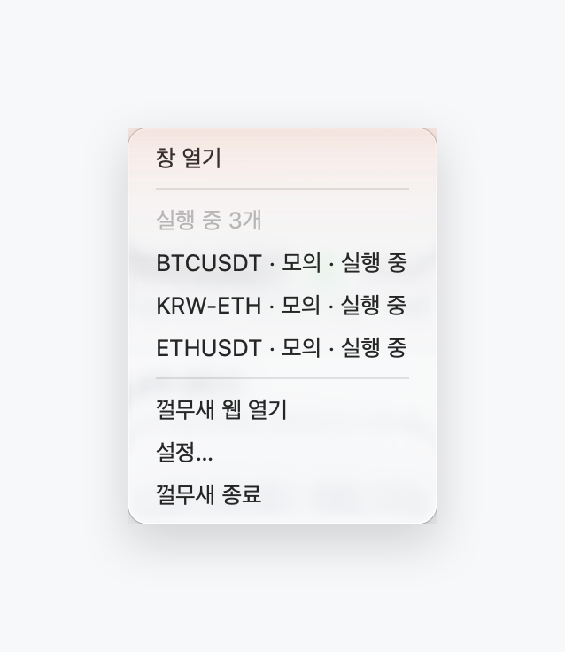 | 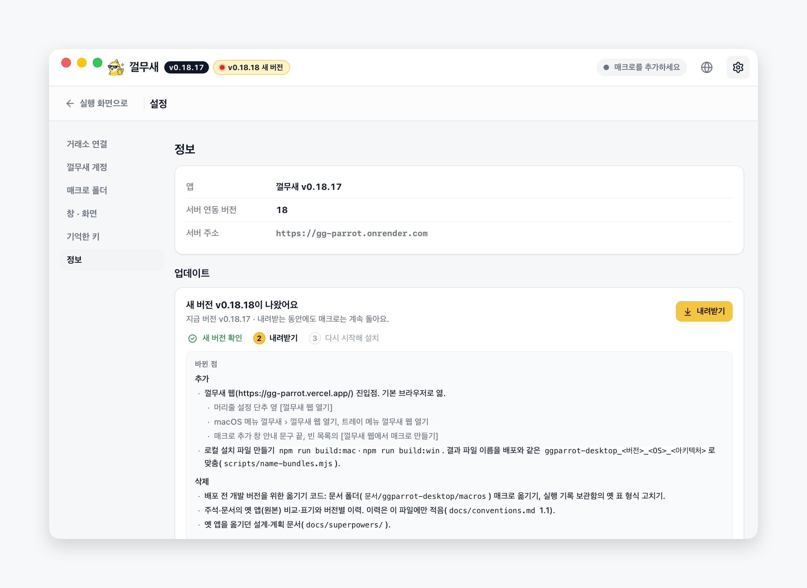 |
| **연결 도우미·예시 화면** | |
| 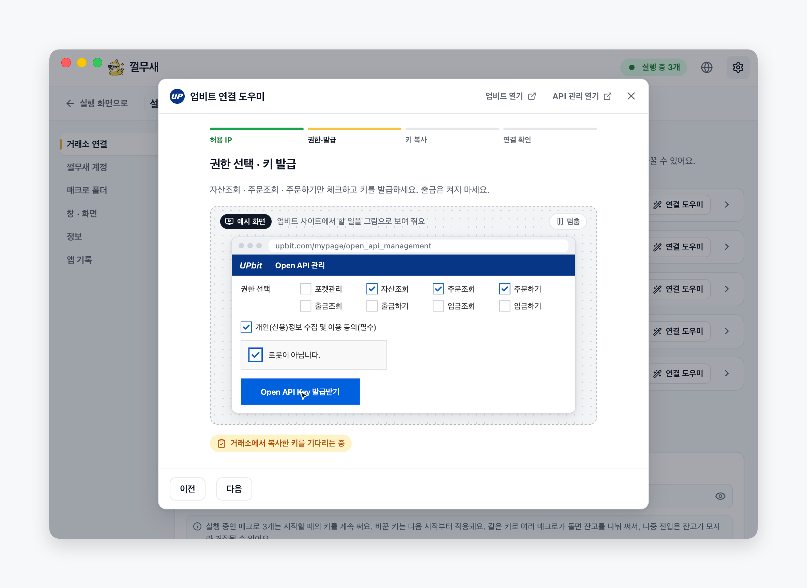 | |

- 화면은 모두 실제 앱(0.21.x)을 가짜 서버·모의 모드로 띄워 찍음. 공인 IP는 문서용 주소(`203.0.113.24`).

업데이트(로컬 업데이트 서버로 실제 설치까지 시험한 화면):

| 새 버전 알림(로고 옆·설정 › 정보) | 내려받는 중 |
|---|---|
| 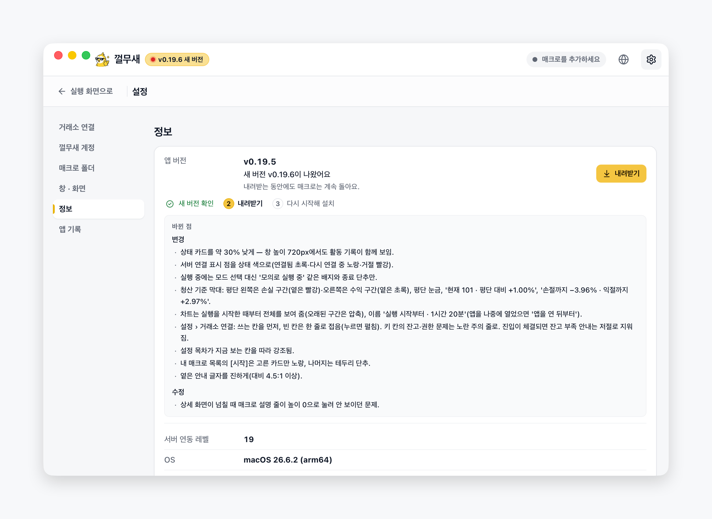 | 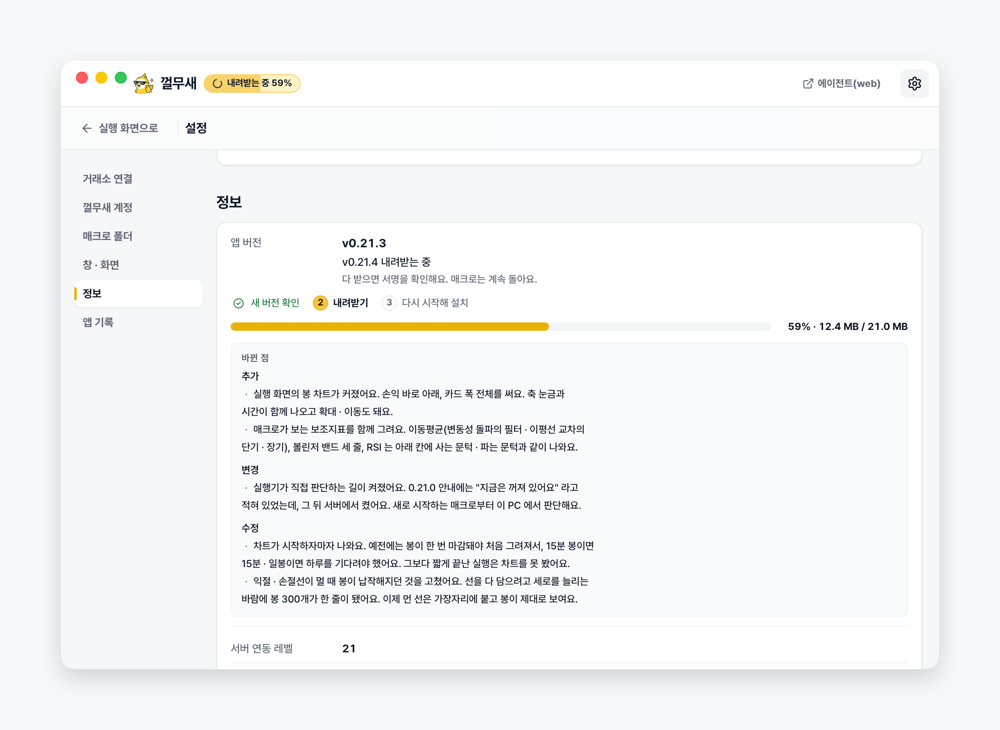 |
| **설치 준비(실행 중인 매크로를 모두 종료한 뒤)** | **다시 시작 후** |
| 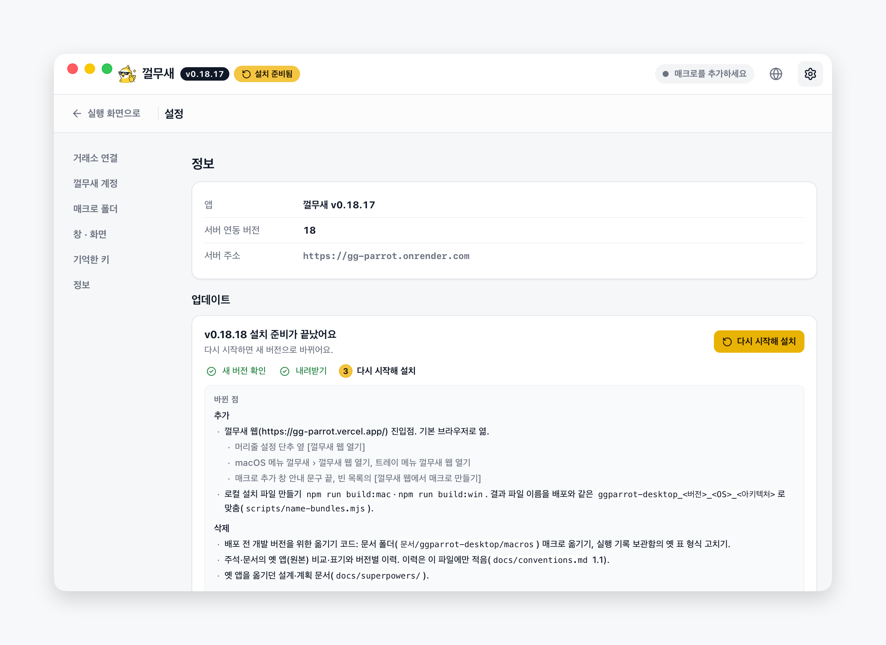 | 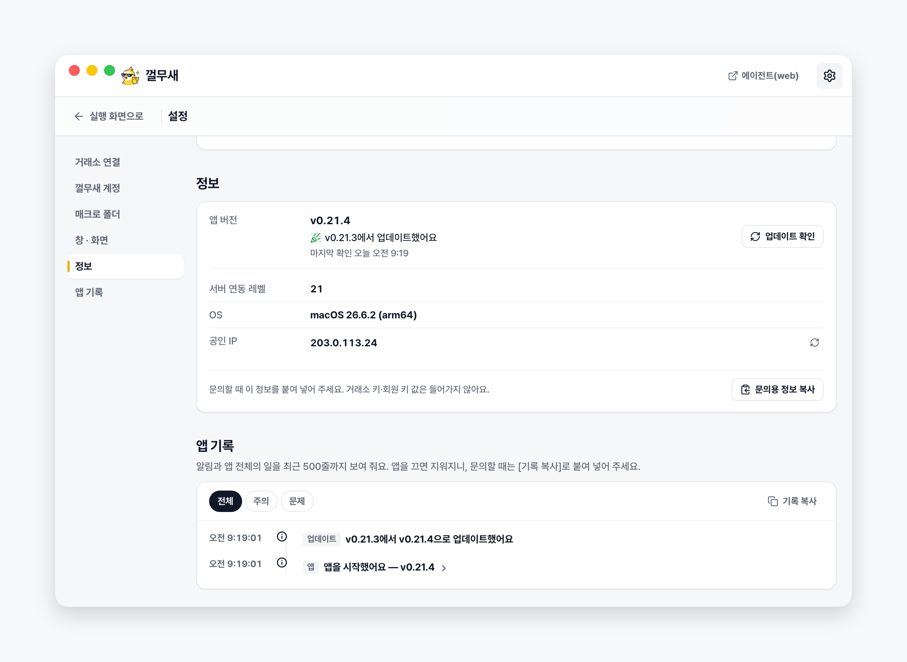 |

설치 화면:

| macOS 디스크 이미지 | Windows 설치 프로그램 그림 |
|---|---|
| 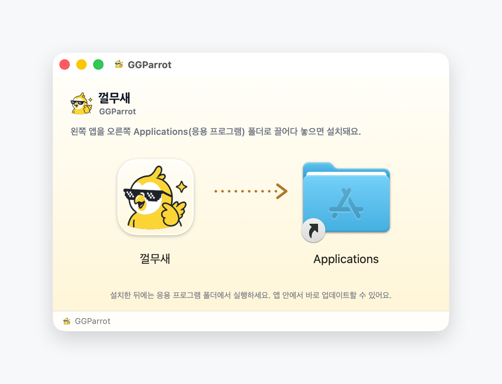 | 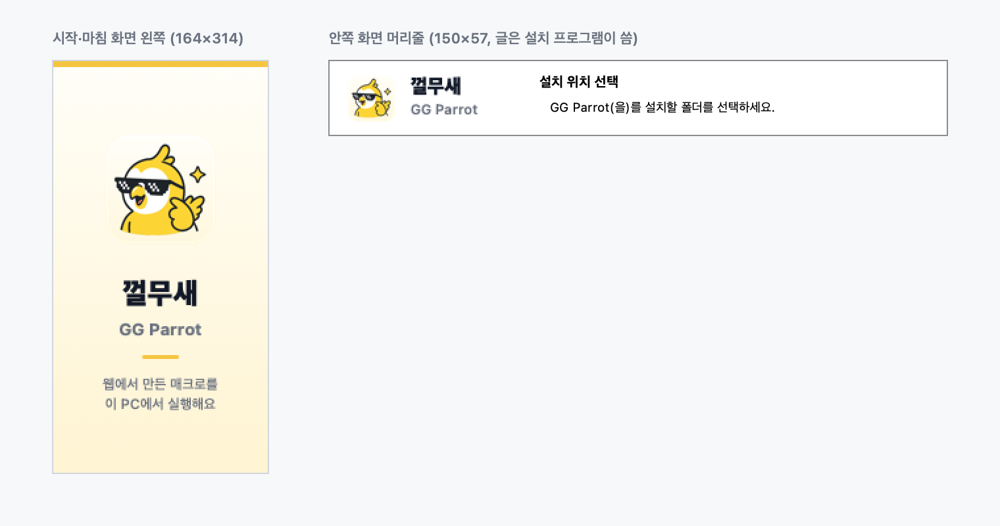 |

## 동작

- 매크로는 파일(`.ggm.json`)로 열거나 웹의 **실행기 열기**(`ggparrot://launch/...`)로 받음.
- 실행 모드는 모의(기본)·테스트넷(바이낸스만)·실전.
  - 실전은 확인 창을 한 번 더 거침.
- 시작하면 서버에 세션을 만들고 5초마다 상태를 보냄.
- 매매 판단을 누가 할지는 서버가 세션마다 정함(시작 응답의 `decides`).
  - `local`(지금 서버에서 켜 둠): 앱이 거래소 공개 시세에서 마감봉을 받아 이 PC에서 사고팔 판단을 함. 체결은 하트비트로 서버에 보고함.
  - `server`: 진입·청산은 서버 명령으로만 함.
  - 앱 엔진은 서버 엔진(파이썬)과 같은 답을 내야 함 — 판단 계약 `tests/fixtures/engine_golden.json`으로 잼.
- 손절·일일 최대손실·최대 보유시간 안전망은 어느 쪽이든 앱이 지킴.
- 마이페이지 **내 매크로 실행 현황**에서 원격으로 **매크로만 종료** 또는 **청산 후 종료**를 할 수 있음.
- 거래소 API 키·시크릿은 서버로 보내지 않음.
  - 서버로 가는 것은 회원 키와 구동 상태·실행 기록뿐임.
- 실행 기록은 서버가 저장했다고 답한 것만 지움.
  - 그 전까지 로컬 보관함(SQLite)에 남겨 껐다 켜도 이어서 보냄.

## 기능

| 항목 | 내용 |
|---|---|
| 플랫폼 | macOS `.dmg`·Windows 설치 파일(`-setup.exe`, 사용자 폴더에 설치·관리자 권한 불필요) |
| 실행 | 여러 매크로 동시 실행(같은 거래소·종목은 하나만) |
| 화면 | 실행 목록·상세, 따로 여는 설정 화면, 사람이 읽는 활동 기록(원문은 개발자 로그), 코인 로고 |
| 차트 | 매크로가 보는 봉 그대로(`lightweight-charts`) — 이동평균·볼린저 밴드·RSI 지표선과 사는·파는 선·손절선·트레일·격자 칸. 확대·이동 됨 |
| 테마 | 시스템·라이트·다크(설정 › 창·화면) |
| 알림 | 체결·평가손익 ±2%부터 구간마다·주문 오류와 잔고 부족·서버 끊김·실행 멈춤을 OS 알림으로 띄움. 설정에서 끌 수 있음 |
| 키 | OS 키체인(macOS 키체인·Windows 자격 증명 관리자)에 둠. 설정 한곳에서 언제나 고침. 바이낸스는 실거래·테스트넷(현물)·데모(선물) 키 칸이 따로 |
| 매크로 파일 | 앱 데이터 폴더의 `macros` 목록·가져오기·끌어다 놓기·웹 [실행기 열기] |
| 껄무새 웹 | 머리줄 [에이전트(web)] 단추·메뉴(껄무새 › 껄무새 웹 열기)·트레이·매크로 추가 창에서 https://gg-parrot.vercel.app/ 을 기본 브라우저로 엶 |
| 바이낸스 연동 | REST API에 직접 서명해 부름 |
| 웹 연결 등록 | 설치할 때 `ggparrot://`를 등록함. Windows는 켤 때 HKCU 등록을 다시 함 |
| 업데이트 | 앱 안에서 확인·내려받기·설치·다시 시작(서명 확인) |
| 창 닫기 | 메뉴 막대·알림 영역 아이콘으로 숨어 계속 실행(macOS는 Dock 아이콘도 숨김). 설정에서 끌 수 있음 |

- 로컬 파일은 모두 앱 데이터 폴더 `ggparrot-desktop` 하나에 있음(macOS `~/Library/Application Support`, Windows `%LOCALAPPDATA%`).
  - 매크로 폴더 `macros/`
  - 실행 목록 `runs.json`
  - 설정 `prefs.json`
  - 실행 기록 `activity/`
  - Windows 화면(WebView2) 데이터 `EBWebView/` — Tauri의 앱 폴더도 같은 곳으로 모음(`tauri.conf.json`의 `appDirectoriesOverride`)
- 실행 목록에는 키가 들어가지 않음.
- 키체인 항목 이름은 `ggparrot-desktop`.
- 웹에서 받은 매크로 파일은 브라우저의 다운로드 폴더에 저장됨.
  - 창에 끌어다 놓거나 [폴더로 가져오기]로 넣음.
- 웹의 [실행기 열기]는 파일 없이 바로 연결함.

## 서버와 앱의 역할 — 서버가 멈추면

- 매매 판단은 세션마다 서버가 정한 쪽이 함 — 앱 판단(`local`, 지금 서버에서 켜 둠) 또는 서버 판단(`server`).
- 앱 판단이면 서버가 멈춰도 매매가 이어짐. 서버 판단이면 앱이 스스로 하는 것은 안전망뿐임.

| 일 | 앱 판단(`local`) | 서버 판단(`server`) | 서버와 연결이 끊기면 |
|---|---|---|---|
| 진입(매수·공매도) | 앱 엔진(마감봉) | 서버 전략의 명령 | 앱 판단은 계속함, 서버 판단은 새 진입 멈춤 |
| 전략의 청산 신호 | 앱 엔진(마감봉) | 서버 전략의 명령 | 앱 판단은 계속함, 서버 판단은 하지 않음 |
| 손절 %·하루 최대 손실·최대 보유시간 | 앱(매크로의 `risk`) | 앱(매크로의 `risk`) | 계속 지킴 — 닿으면 앱이 바로 청산 |
| [청산 후 종료]·[매크로만 종료] | 사용자 | 사용자 | 됨 |
| 웹의 종료·정리 요청 | 웹 → 서버 → 앱 | 웹 → 서버 → 앱 | 전달되지 않음 — 앱에서 종료해야 함 |

- 끊긴 동안 화면·트레이에 '서버 재시도 중'이 보이고, 5분이 넘으면 따로 알림.
- 앱이 꺼져 있거나 PC가 잠들면 안전망도 멈춤.
- 서버 판단일 때 앱이 안전망으로 청산한 사실은 아직 서버 전략에 반영되지 않음 — [서버 설계](docs/server-stop-loss-design.md).

## 개발

- 필요한 도구: Node 22.12 이상(`.nvmrc`는 26 LTS), Rust stable(`src-tauri/rust-toolchain.toml`).
- macOS에서 설치 파일까지 만들려면 Xcode가 필요함.

```bash
npm install
```

```bash
npm run tauri dev
```

- 브라우저만으로 화면을 확인하려면 `npm run dev`를 실행하고 http://localhost:1420 을 엶.
- Tauri 밖에서는 가짜 백엔드(`src/mock.ts`)가 붙음.

테스트:

```bash
npm test
```

```bash
cd src-tauri && cargo test --workspace
```

- 화면 배치 검사(Playwright)는 webkit(macOS)·chromium(Windows) 엔진으로 가짜 백엔드 미리보기를 띄워 겹침·넘침을 잼.
- 처음 한 번 브라우저를 받음(`npm run test:e2e:install`). 결과 보고서·스크린샷은 `playwright-report/`·`test-results/`에 남음.

```bash
npm run test:e2e
```

- 포맷은 oxfmt(TS·CSS·JSON·YAML, 폭 120)와 rustfmt(폭 120)로 맞춤.
- CI가 `format:check`로 확인함.

```bash
npm run format
```

- 린트는 oxlint(TS·React, 타입 정보 검사 포함)와 clippy(Rust). 경고도 실패로 봄.

```bash
npm run lint
```

로컬 백엔드에 붙이려면 서버 주소를 바꿈.

```bash
GGP_SERVER_BASE=http://localhost:8000 npm run tauri dev
```

- 시험용 환경변수: 1회 주문 상한 `MAX_ORDER_USDT`(기본 100)·`MAX_ORDER_KRW`(기본 150000), 선물 상한 기준 `ORDER_CAP_BASIS`(`notional` | `margin`), 회원 키 미리 채우기 `GGP_MEMBER_KEY`.
- `GGP_MACRO_DIR`로 매크로 폴더를 바꿀 수 있음.
- 전체 목록은 `.env.example`에 있음.
설치 파일 만들기(로컬):

```bash
npm run build:mac
```

```bash
npm run build:win
```

- 결과 파일 이름은 배포와 같음: `ggparrot-desktop_<버전>_darwin_universal.dmg`·`ggparrot-desktop_<버전>_windows_x64-setup.exe`.
  - Tauri는 화면 이름(`GGParrot`)으로 파일을 만들고, `scripts/name-bundles.mjs`가 기술 이름으로 바꿈.
  - 위치: `src-tauri/target/universal-apple-darwin/release/bundle/dmg/`·`src-tauri/target-win/x86_64-pc-windows-gnu/release/bundle/nsis/`.
- `build:mac`은 `rustup target add x86_64-apple-darwin`이 한 번 필요함(Apple Silicon·Intel 공용 빌드).
- `build:win`은 macOS에서 Windows 설치 파일을 만듦(배포는 CI의 Windows 러너가 MSVC로 만듦).
  - `brew install nsis mingw-w64`가 필요함.
  - `makensis`는 UTF-8 로캘이 아니면 한글 이름에서 멈춤(스크립트가 로캘을 맞춤).

## 구조

```
src/                      React + TypeScript 화면 (상태는 Rust 가 소유, 화면은 스냅샷만 그림)
  types.ts                Rust ↔ 화면 계약
src-tauri/src/            Tauri 앱 레이어 (명령 · 상태 · 트레이 · 연결 도우미 · 딥링크 · 단일 인스턴스)
src-tauri/crates/runner-core/
  brokers/                바이낸스 · 업비트 · 빗썸 · 모의
  bot/                    실행 루프 · 주문 · 보고 · 앱 판단(local.rs)
  engine/                 매매 판단 엔진 — 규칙 · 지표 · 장부 · 차트 지표선(서버와 같은 답, 판단 계약)
  candles.rs              거래소 공개 시세의 마감봉(봉 간격 격자는 intervals.rs)
  server.rs · server/     서버 클라이언트
  outbox.rs               실행 기록 보관함
  credentials.rs          키체인 저장 규칙
  connection.rs           연결 검사 · 공인 IP · 키 마스킹
docs/                     규칙 · 다음 작업 · 설계 문서
```

## 설치·업데이트

- 설치 파일 이름은 기술 이름(`ggparrot-desktop`): `ggparrot-desktop_<버전>_darwin_universal.dmg`(Apple Silicon·Intel 공용)·`ggparrot-desktop_<버전>_windows_x64-setup.exe`.
- 설치한 앱의 이름은 화면 이름: macOS `GGParrot.app`, Windows 시작 메뉴·바탕화면·프로그램 목록 '껄무새'.
- **macOS**:
  - `.dmg`를 열고 앱을 응용 프로그램 폴더로 끌어 놓음.
  - Finder·Dock에는 macOS 언어가 한국어면 '껄무새', 아니면 'GGParrot'으로 보임.
  - 디스크 이미지나 다운로드 폴더에서 바로 실행하면 업데이트를 설치할 수 없어 앱이 옮기라고 안내함.
- **Windows**:
  - `-setup.exe` 하나만 배포함(MSI 없음).
  - 사용자 폴더 `%LOCALAPPDATA%\Programs\GGParrot`에 설치하므로 관리자 권한이 필요 없음.
  - 설치·제거 화면, 시작 메뉴, 프로그램 제거 목록, 작업 관리자에는 '껄무새'로 보임(`tauri.windows.conf.json`의 productName).
  - Windows에서 쓰는 곳은 두 군데뿐임: 프로그램 `%LOCALAPPDATA%\Programs\GGParrot`, 데이터 `%LOCALAPPDATA%\ggparrot-desktop`. 레지스트리는 `HKCU\Software\GGParrot`·프로그램 제거 항목 `GGParrot`·`ggparrot://` 연결.
  - 제거할 때 '애플리케이션 데이터 삭제하기'를 고르면 데이터 폴더(매크로 폴더 포함)도 지움. 키는 Windows 자격 증명 관리자에 남음(설정 › 기억한 키에서 지움).
  - 앱이 실행 중이면 설치·제거 프로그램이 끄고 계속할지 물음(트레이로 숨어 도는 앱이라 Windows 기본 종료 요청으로는 꺼지지 않음 — `src-tauri/installer/hooks.nsh`).
  - 설치 프로그램은 Tauri 기본 템플릿을 고친 `src-tauri/installer/installer.nsi`를 씀(한국어 이름·영문 폴더). Tauri를 올리면 같은 버전의 원래 템플릿과 비교해 맞춤.
- **앱 안 업데이트**:
  - 켤 때와 6시간마다 확인함.
  - 새 버전이 있으면 머리줄의 앱 이름 옆에 알림이 뜸. 지금 버전은 설정 › 정보에서 봄.
  - 설정 › 정보 › 업데이트에서 내려받기를 누르면 진행 막대와 크기가 보이고, 이때는 매크로가 계속 돎.
  - 다 받으면 서명을 확인하고 **다시 시작해 설치**를 누를 때 설치함.
  - 실행 중인 매크로가 있으면 설치하지 않음.
  - Windows는 설치 창이 잠깐 뜬 뒤 다시 켜짐.
- 설치 화면 그림(`src-tauri/installer/`)은 `swift scripts/installer-art.swift`로 다시 만듦.
- 앱·트레이 아이콘 원본은 `assets/*.svg`. `src-tauri/icons/`에는 번들(`tauri.conf.json`의 `bundle.icon`)과 트레이(`tray.rs`)가 쓰는 파일만 둠.
- 견본 매크로: `docs/samples/btc-rsi.ggm.json`(창에 끌어다 놓아 시험).

## 배포

- 저장소: https://github.com/orbleeparrot/ggparrot-desktop
- 설치 파일·업데이트 파일은 모두 이 저장소의 **GitHub Releases** 한 곳에 둠. 다른 패키지 저장소(GitHub Packages·npm 등)는 쓰지 않음.

| 무엇 | 어디 |
|---|---|
| 설치 파일(`.dmg`·`-setup.exe`) | Releases의 각 버전 |
| 업데이트 묶음·서명(`.app.tar.gz`·`.sig`·`-setup.exe.sig`) | 같은 릴리스 |
| 업데이트 목록(`latest.json`) | 같은 릴리스. 앱은 `releases/latest/download/latest.json`을 읽음 |
| 업데이트 서명 키 | Settings › Secrets and variables › Actions의 `TAURI_SIGNING_PRIVATE_KEY`·`TAURI_SIGNING_PRIVATE_KEY_PASSWORD`(로컬 키 파일: `~/.tauri/ggparrot-desktop-updater.key`, 공개키는 `tauri.conf.json`) |

순서(자동):

1. 작업 브랜치의 PR 마지막에 버전을 하나 올리고 `CHANGELOG.md`에 그 버전 칸을 적음. PR을 `main`에 스쿼시 머지함(브랜치·머지 규칙은 `docs/conventions.md` 6).
2. CI가 통과하면 **release** 워크플로가 그 버전의 릴리스 **초안**을 자동으로 만듦.
   - macOS(universal)·Windows 설치 파일과 앱 업데이트 파일을 붙임 — 초안에서 바로 내려받아 시험할 수 있음.
   - 본문은 CHANGELOG에서 자동으로(사용자용 분류만, 지난 배포 태그 뒤의 버전 칸을 합침, `### 개발`은 뺌).
   - 맨 아래 설치 안내(`<!-- web-only -->` 아래)는 웹 릴리스 페이지에만 보이고 앱의 '바뀐 점'에는 보이지 않음.
   - 이전 초안은 지우고 최신 커밋의 초안 하나만 남김. 초안은 사용자와 앱 업데이트에 보이지 않음.
3. Releases에서 초안을 확인하고 [Publish release]를 누름 — **이때 배포됨.**
   - 태그 `v<버전>`이 이때 생기고, 앱의 업데이트 확인이 새 버전을 봄(latest 릴리스만 읽음).
   - CHANGELOG에는 배포 표시를 하지 않음 — 다음 배포는 이 태그 뒤의 칸만 합침(`main`에 자동 커밋 없음).
4. 주의
   - 초안 본문을 GitHub에서 고치면 웹 페이지만 바뀜. 앱의 '바뀐 점'은 빌드 때 CHANGELOG 내용 — 고치려면 CHANGELOG를 고치는 PR을 머지(초안이 새로 만들어짐).
   - Publish한 릴리스는 파일을 바꿀 수 없음(Settings › General › Releases › Enable release immutability). 잘못 나갔으면 버전을 올려 다시 배포.
   - 미리 보기: `git fetch --tags` 뒤 `npm run release:notes -- v<버전>`. 초안을 다시 만들려면 Actions › release › [Run workflow](main).

참고:

- 앱 안 업데이트는 서명된 파일만 설치함.
- 워크플로의 액션은 커밋 SHA로 고정해 둠(Dependabot이 올림, 저장소 설정으로도 강제).
- 태그 이름은 환경변수로만 스크립트에 넘김.
- 코드 서명: macOS는 Apple 인증서가 없으면 임시 서명(ad-hoc), Windows는 서명 없음. 첫 실행 때 경고가 뜸. 넣는 방법은 [docs/code-signing.md](docs/code-signing.md).

웹 연동:

- 웹(`gg_parrot/frontend`)은 지금 Windows에서만 실행기를 안내함.
  - macOS에서 **실행기 열기**를 쓰려면 웹의 OS 판별과 다운로드 링크(`runnerDownload.js`, `backend/app/runner_release.py`)를 따로 갱신해야 함.

## 주의

- 실거래(실전 모드)는 실제 자금이 움직임.
- 이 프로그램은 투자 조언이 아니며 손익 책임은 사용자에게 있음.
